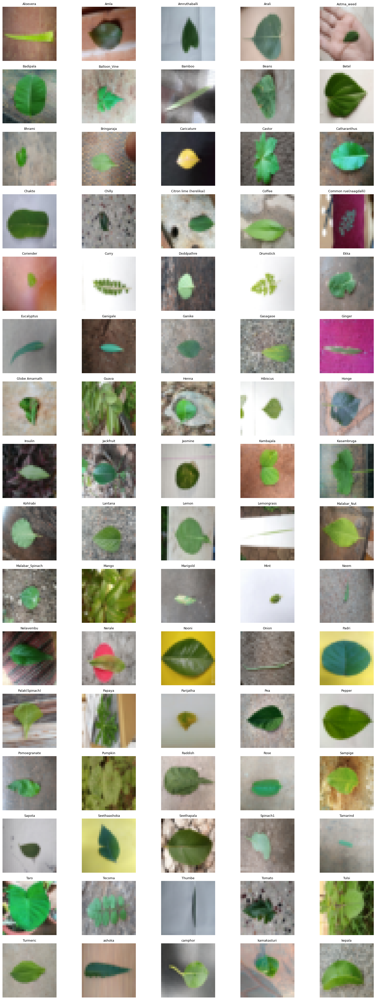
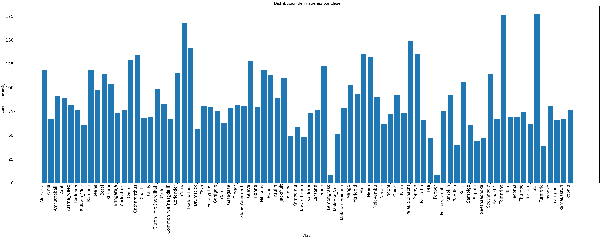

# 🌿 Reconocimiento de plantas medicinales con CNN

Modelo de **deep learning** que clasifica fotos de hojas en **80 especies de plantas medicinales**, usando una red neuronal convolucional (CNN) construida desde cero con **PyTorch**.

<a href="https://colab.research.google.com/github/idkferr/reconocimiento-plantas-medicinales/blob/main/plantas_medicinales_cnn.ipynb"></a>

## 📊 Dataset

[Indian Medicinal Leaves Dataset](https://www.kaggle.com/datasets/aryashah2k/indian-medicinal-leaves-dataset) (Kaggle): **6.900 imágenes** de hojas de 80 especies, como aloe vera, tulsi, neem, menta, cúrcuma, jengibre o eucalipto. El notebook lo descarga automáticamente con `kagglehub`.

| Conjunto | Imágenes | % |
|---|---|---|
| Entrenamiento | 4.830 | 70 % |
| Validación | 1.035 | 15 % |
| Prueba | 1.035 | 15 % |



<details>
<summary>Distribución de imágenes por clase</summary>



</details>

## 🧠 Modelo

```
Imagen 28×28 RGB
 → Conv2d(3→32, 3×3) + ReLU + MaxPool 2×2
 → Conv2d(32→64, 3×3) + ReLU + MaxPool 2×2
 → Linear(64·7·7 → 128) + ReLU
 → Linear(128 → 80 clases)
```

- **Preprocesamiento:** redimensionar a 28×28, convertir a tensor y normalizar a [-1, 1]
- **Pérdida:** `CrossEntropyLoss` (incluye softmax)
- **Optimizador:** Adam, tasa de aprendizaje 0,001
- **Entrenamiento:** 10 épocas, lotes de 64 imágenes, en GPU si hay una disponible

## 📈 Evaluación

El notebook registra la pérdida y la exactitud de entrenamiento y validación en cada época, y las grafica. Sobre el conjunto de prueba calcula:

- reporte de clasificación por clase (precisión, recall y F1)
- **recall** y **F1** macro-promediados
- **matriz de confusión** de 80×80

Resultados de la ejecución guardada en el notebook, que se detuvo en la época 8:

| Época | Exactitud entrenamiento | Exactitud validación |
|---|---|---|
| 1 | 6,8 % | 10,9 % |
| 4 | 36,4 % | 32,4 % |
| 7 | 54,2 % | 43,0 % |

El modelo sigue mejorando época a época. Con 80 clases, una clasificación al azar acertaría un 1,25 %.

## 🔭 Mejoras posibles

- Usar imágenes más grandes que 28×28 (por ejemplo 128×128), porque a esa resolución se pierde la textura de la hoja
- Aumentar los datos con rotaciones, volteos y cambios de brillo
- *Transfer learning* con un modelo preentrenado (ResNet, EfficientNet)
- Agregar *dropout* y *early stopping* para reducir el sobreajuste

## 🚀 Cómo ejecutarlo

Lo más simple es usar el botón **Abrir en Colab** de arriba y elegir un entorno con GPU.

Para ejecutarlo en tu computador:

```bash
git clone https://github.com/idkferr/reconocimiento-plantas-medicinales.git
cd reconocimiento-plantas-medicinales
pip install -r requirements.txt
jupyter notebook plantas_medicinales_cnn.ipynb
```

`kagglehub` puede pedir que inicies sesión en Kaggle para descargar el dataset.

## 🛠️ Tecnologías

Python · PyTorch · torchvision · scikit-learn · matplotlib · Google Colab · KaggleHub
